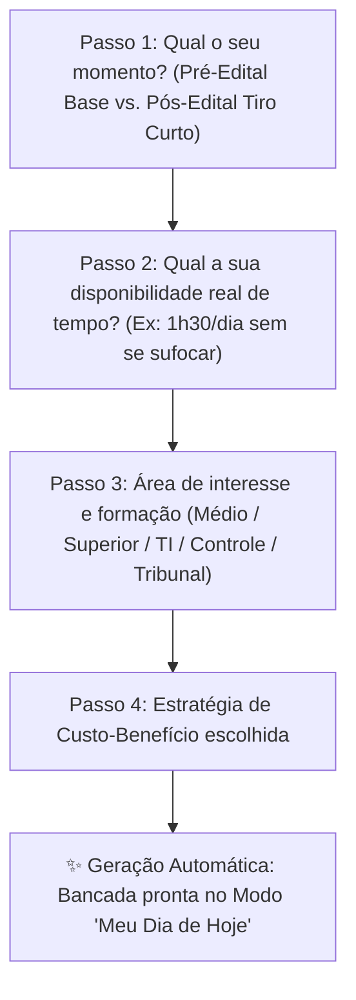

# 🧭 Spec 05 — Onboarding Wizard, Visão "Meu Dia de Hoje" & Explicabilidade sob Demanda

## 🎯 1. O Problema & A Visão Humana
Estudantes fora da bolha tech ou com rotinas densas (ex: mães, trabalhadores em transição de carreira, estudantes no 1º concurso) sofrem de **parálise por sobrecarga**:
- **Sobrecarga de botões:** Abrir uma ferramenta cheia de abas técnicas, mapas e grafos causa ansiedade e desistência nos primeiros 5 minutos.
- **Falta de clareza do Custo-Benefício:** Não sabem quanto tempo dedicar para cada disciplina, quais matérias **não valem a pena** o esforço pelo tempo que têm, ou como saber se estão realmente evoluindo.
- **A Promessa FofoLab:** *"Sentar na cadeira, ligar o PC, abrir o FofoLab e estudar direto o que dá mais resultado hoje, sem precisar procurar ou tomar 10 decisões antes."*

---

## 🧙‍♂️ 2. O Onboarding Wizard ("Pegar pela Mão")
Executado no 1º acesso (ou acessível via botão *"Recalibrar Meu Perfil"*):

### Estratégias de Custo-Benefício (Passo 4):
1. **🛡️ Garantir 100% da Base Comum (Recomendada no Pré-Edital):** Foco nas matérias coringa (Português, Raciocínio Lógico, Dir. Administrativo e Constitucional) para garantir aprovação em qualquer concurso que abrir.
2. **🎯 Atacar o que mais cai e onde tenho mais dificuldade:** Foco baseado nos dados de provas anteriores e nos tópicos com maior probabilidade de questão.
3. **⚡ Tiro Curto de Pós-Edital (Alta Rentabilidade):** Prioridade máxima para as matérias com maior peso na prova e descarte planejado de tópicos de baixo custo-benefício.

### Como o Wizard age de verdade (implementado na Fatia 5.5)
- O perfil é gravado **no plano** (`study_plans.weekly_hours_target`, `strategy_mode`, `study_moment`), não no localStorage. O localStorage guarda só a marca "assistente já visto".
- Ao concluir, o Wizard **aplica ao ciclo** a distribuição recomendada pela estratégia (é a "Geração Automática"). Fora do Wizard, mudanças de prioridade continuam sendo só **sugestão** ("Aplicar Sugestão no Próximo Ciclo").
- O momento (pré/pós-edital) pré-seleciona a estratégia (Pré → Base Comum; Pós → Alta Rentabilidade) até o estudante escolher outra.
- **Multiplicadores v1** sobre a prioridade de cada disciplina (`STRATEGY_FACTORS` em `src/lib/cycleEngine.ts`), sem estratégia = 1:
  - *Base Comum:* Básico ×1,3 • Geral ×1,1 • Específico ×1,0.
  - *O que mais cai / pontos fracos:* 1 + 0,06 × calor médio dos tópicos (a parte "o que mais cai" vai usar a frequência das questões das provas importadas — Fatia 7).
  - *Alta rentabilidade:* (peso ÷ peso médio)^0,75.

### Como o "Meu Dia" escolhe os blocos (`src/lib/dailyPlanner.ts`)
- Matérias ordenadas pelo que **falta do ciclo nesta semana** (minutos do ciclo − minutos registrados no Pomodoro desde segunda), empate pela prioridade.
- Até 2 blocos: com até 1h/dia, um bloco; acima disso, 60%/40% do tempo do dia, sem passar do que falta da matéria (mínimo 20 min).
- Semana toda cumprida → blocos extras de revisão pela maior prioridade.
- "Iniciar Estudo Direto" abre a bancada no tópico e ajusta o Pomodoro para a duração do bloco.

---

## 📅 3. A Visão "Meu Dia de Hoje" (Modo Essencial)
Em vez de navegar por toda a árvore do edital, o aluno vê uma tela limpa e acolhedora:

1. **Cartão do Dia:** *"Hoje você tem 1h30 (90 min). Aqui está seu roteiro de maior retorno:"*
   - **Bloco 1 (50 min):** [Matéria A • Tópico X] — *Por que hoje:* Peso 2x na sua prova e você está iniciando o assunto.
   - **Pausa sugerida (10 min)**
   - **Bloco 2 (30 min):** [Matéria B • Tópico Y] — *Por que hoje:* Revisão rápida de um ponto fraco do seu Mapa de Calor.
2. **Botão de Ação Direta:** `[ Iniciar Estudo de Hoje 🚀 ]` ➔ Abre o Pomodoro já configurado, o caderno daquele tópico e as questões comentadas.
3. **Alternador de Experiência no Topo:** Um botão discreto `[ Modo Essencial ("Meu Dia") | Bancada Completa Pro ]` para o usuário alternar quando quiser.

---

## 💡 4. Explicabilidade Discreta sob Demanda (`?` / `ⓘ`)
Um componente reutilizável `MetricExplainerTooltip` em 2 níveis:
- **Nível 1 (Linguagem Humana do Dia a Dia):** Explicação contextual gerada com os dados reais do estudante em 1 frase simples (ex: *"Esta disciplina tem prioridade 8.5 porque vale o dobro de pontos na CGU e seu último estudo nela foi há 12 dias"*).
- **Nível 2 (Expansível - "Ver cálculo detalhado"):** Abre a fórmula e os pesos matemáticos (Peso da Prova + Meia-vida da memória HLR + Confiança da amostra BM25) para quem quiser ver os bastidores.

---

## 📺 5. Módulo de Vídeo / Navegador Gran & YouTube (Backlog Futuro)
- Aba dedicada no aplicativo com mini-navegador ou leitor de título de janela.
- Reconhece o título da aula ativa no Gran ou YouTube e sincroniza automaticamente o tópico correspondente no FofoLab, sem necessidade de integrações complexas ou instáveis de API.

